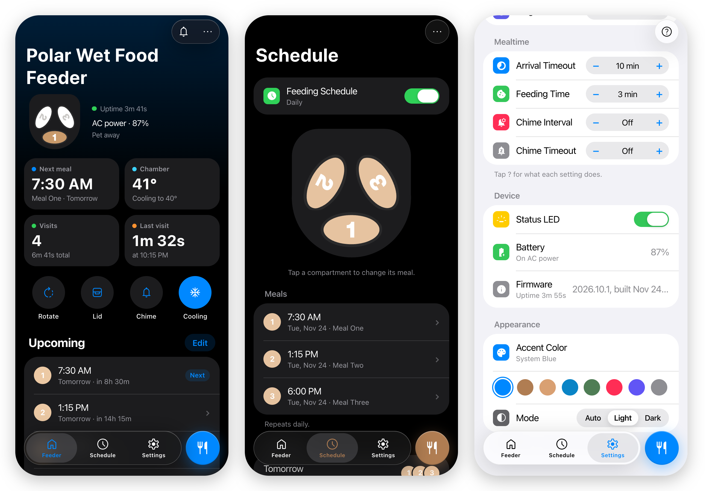

# ESPHome for PetLibro Devices

## Overview

Alternative DIY open-source [ESPHome firmware](https://esphome.io) for the [Petlibro](https://petlibro.com) PLAF109 Polar Wet Food Feeder. Originally forked from [taylorfinnell/petlibro-esphome](https://github.com/taylorfinnell/petlibro-esphome); this repository now focuses exclusively on the PLAF109.

PetLibro makes WiFi-connected pet food feeders and water fountains based on ESP8266/ESP32 microcontrollers from Espressif. Their factory firmware requires you to create an account and remain connected to their cloud to be functional. We have good reason not to trust PetLibro with our privacy due to [their exceptionally poor handling of vulnerabilities in the past](https://bobdahacker.com/blog/petlibro).

This ESPHome firmware implements local LAN support with feature-parity as stock firmware without need for cloud/WAN connection.



[PLAF109](plaf109/#on-device-web-dashboard) includes an optional on-device web dashboard, so it can be controlled from a phone without Home Assistant. Screenshot uses mocked data.

**Related repositories and alternatives:**

- Original ESPHome Repository: <https://github.com/taylorfinnell/petlibro-esphome/>
- MQTT DNS intercept for PLAF203, no flashing required but no control over code executed on device: <https://github.com/icex2/plaf203/>
- MQTT DNS intercept for a number of devices, no flashing required but no control over code executed on device: <https://github.com/smcneece/petlibro-local/>
- HAOS Support with official servers, no privacy improvement: <https://github.com/jjjonesjr33/petlibro/>
- PLAF109 UI, used in this repo: <https://github.com/sylphrena0/petlibro-esphome-plaf109-ui/>

Please note that this software is provided without any explicit or implied warranty, and maintainers of this repository claim no responsibility for potential damage to your device, voiding of factory warranty, or any other damage caused.

## Supported Devices

- [PLAF109](plaf109/) - Polar Wet Food Feeder (refrigerated)

## Flashing ESPHome

### Connecting via Serial

Requirements:

- [Latest version of esptool](https://github.com/espressif/esptool/releases)
- [USB to Serial Adapter](https://www.adafruit.com/product/5994). You will need at least support for TTL and for proper support, buy an adapter with full RS232 serial support.
- Follow the instructions in the README specific to your device to disassemble your device and connect to your board with the serial adapter before proceeding.
  - Ideally, you should solder headers to at least GND/TX/RX/VCC, but you may be able to flash by holding contacts to the board instead.
  - You will also need to follow the instructions specific to your device to boot the device in programming mode.
- Once done, confirm you have a good connection with `./esptool read-mac`. This will also inform you of which serial port to use later on. Note this down.

### Dumping Stock Firmware

Before flashing the firmware, you should backup the stock firmware. The firmware installed from the factory includes data unique to your device, such as the internal ID and cryptographic keys used to communicate with the cloud server, so if you wish to be able to return your device to a state where it can communicate with the Petlibro cloud then you'll need to have made a backup.

This can be done by following the instructions for setting up the serial connection for your device in developer mode as per the instructions below, and then running the following `esptool` command with the [latest version of esptool](https://github.com/espressif/esptool/releases):

```bash
./esptool --port /dev/ttyUSB0 --before=default-reset --no-stub read-flash 0x0 ALL petlibro_factory_dump.bin
```

If the read fails, try power cycling the device. In testing, it sometimes would fail to read the file part of the way through unless the device had been cleanly restarted immediately before the dump was initiated.

Place this file somewhere safe, ideally backed up somewhere. Do not share with untrusted parties, this file contains private information about your device.

### Preparing ESPHome

- Install the [ESPHome Device Builder](https://github.com/esphome/device-builder) dashboard, either standalone or as a HAOS addon.
- Add a device to the dashboard according to the instructions in the [PLAF109 README](plaf109/).
- Inside the device on the dashboard, click install, advanced options, and download the firmware binary.

Alternatively, you can use <https://web.esphome.io/> for the initial flash of your device.

### Using as an ESPHome Package

Instead of copying `plaf109/config.yaml` locally, you can pull it in directly from GitHub using ESPHome's [packages](https://esphome.io/components/packages.html) feature, pinned to a floating release tag or main:

```yaml
packages:
  plaf109: github://sylphrena0/petlibro-esphome/plaf109/config.yaml@main  # always build latest
  # plaf109: github://sylphrena0/petlibro-esphome/plaf109/config.yaml@v1  # floating, will update non-major versions
```

Use only one of the lines above. You'll still need a local `secrets.yaml` with the `!secret` keys referenced by the config (WiFi credentials, encryption/OTA keys, web UI login). You can override components as you need, but consider pinning to a specific tag if you do so to avoid your override breaking (though the risk is lower when you have to trigger the re-compile to pull in new changes).

### Flashing Firmware

Next, you'll want to flash ESPHome onto your device.

- Double check that you've backed up the factory firmware somewhere safe.
- Erase the flash on the device by running `./esptool erase-flash`
- Write the ESPHome firmware to your device with `./esptool --port /dev/ttyUSB0 --baud 460800 write-flash 0x0 petlibro-<DEVICE-ID>-firmware.factory.bin` replacing with your actual device id.
- Unless you are doing development work or run into a problem flashing, you're done with the hardware. You can reassemble your device and put away your serial adapter, if you need to flash stock firmware before selling the device, you can do so with an OTA update.

Next, check the [PLAF109 README](plaf109/) for any calibration steps or notes.

## Contributing

Changes are welcome and encouraged. To keep changes reviewable and the changelog organized:

- Title your PR using [Conventional Commits](https://www.conventionalcommits.org/en/v1.0.0/) with a scope matching that folder, e.g. `fix(plaf109): correct lid timing` or `docs(docs): update flashing steps`. Allowed scopes: `plaf109`, `docs`, `ci`.
- Scope each PR to a single top-level folder or file (e.g. `plaf109/`, `README.md`, `.github/`) - one component's changes per PR.

Both are checked automatically on PRs, with a comment left explaining any issue.

## License

Licensed under [GPL-3.0-or-later](LICENSE).
