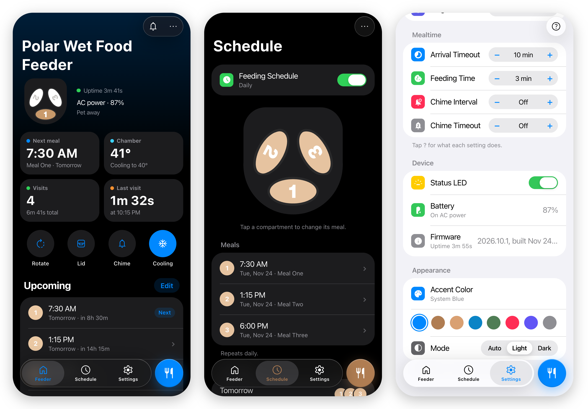

# On-Device ESPHome Web Control for PetLibro PLAF109

A mobile-first remote for the [PetLibro PLAF109](../README.md) (Polar Wet Food Feeder) running ESPHome. Controls are implemented through ESPHome's `web_server` API (`/events` and the REST endpoints). Originally developed in [sylphrena0/petlibro-esphome-plaf109-ui](https://github.com/sylphrena0/petlibro-esphome-plaf109-ui).

This is a ESPHome only solution to take control of your PetLibro Wet Feeder without need for a HAOS server and with UX better than the factory app (IMO). You might be better off with a dashboard in HAOS if you have that available. Don't port forward this application without SSL and authentication.



Fig 1. Feeder, Schedule and Settings tabs using mocked data (this feeder doesn't seem to get that cold).

The UI follows the PetLibro app's layout with an iOS-style look:

- **Feeder**: status, next meal, chamber, visits, and quick actions.
- **Schedule**: the plate and a meal list. Tap a compartment or meal to edit its date and time in a sheet. Changes save on ✓.
- **Settings**: freshness, mealtime and device settings, plus **Appearance**.
- **Feed Now** (the round button next to the tabs) asks for confirmation first.

Appearance lets you pick an accent color and a Light, Dark or Auto (follows the system) mode. These choices are stored in the browser (`localStorage`), not on the device, so each phone keeps its own.

## Usage

When `dashboard: true` (the default), [`../extras/dashboard.yaml`](../extras/dashboard.yaml) embeds `build/app.js` and `build/style.css` into the firmware with `web_server`'s `js_include`/`css_include`, replacing the stock web UI at the device root.

The UI looks entities up by name, so the names in [src/entities.ts](src/entities.ts) have to match the firmware config.

## Development

Requires Node 24 and Yarn (`corepack enable`).

```sh
yarn install
yarn dev # build, then serve a mock feeder at http://localhost:8081
yarn build # build/app.js and build/style.css
yarn lint # also runs in CI
```

`yarn dev` runs [dev-server.mjs](dev-server.mjs), which mocks the ESPHome `/events` stream and REST endpoints so you can work on the UI without a device.

The build output in `build/` is committed so ESPHome can embed it without Node. Run `yarn build` and commit `build/` with any UI change; CI fails if it is out of date.
